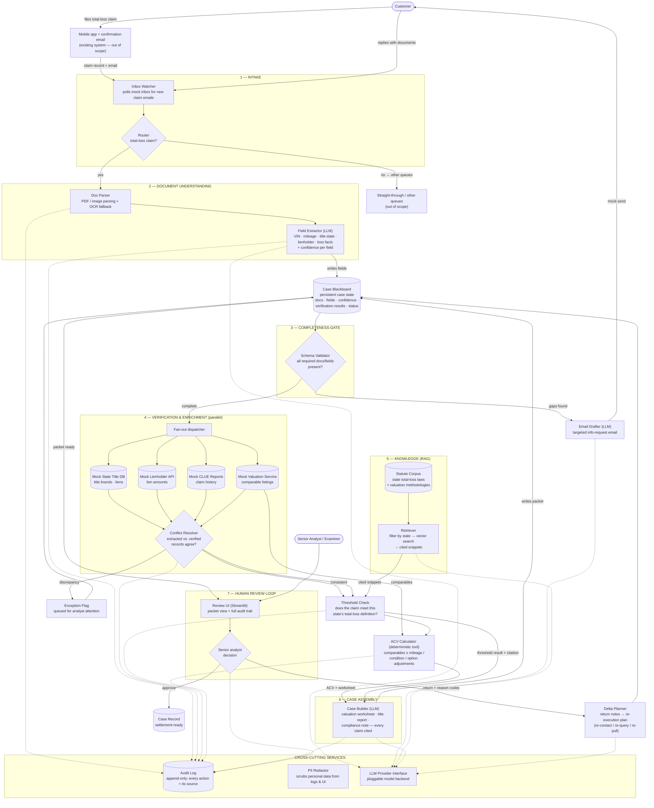

# SettleReady — System Architecture

**Project:** SettleReady — autonomous total-loss case preparation agent
**Category:** Personal Assistant

This document describes the system architecture: what each component does, how data flows
between components, and the design decisions behind the structure. It is written for a
reader with no prior context on the project.

---

## 1. Architecture flowchart

---

## 2. Component glossary

| # | Component | What it does | Key inputs → outputs |
|---|-----------|--------------|----------------------|
| 1 | Inbox Watcher | Polls the (mock) inbox for new claim emails and attachments | Raw emails + PDFs → normalized intake event |
| 2 | Router | Classifies the claim; total-loss goes to the pipeline, everything else to other queues | Intake event → routed claim or out-of-scope |
| 3 | Doc Parser | Extracts text from PDFs/images, with OCR fallback for scans; preserves table layout | Attachments → text + layout blocks |
| 4 | Field Extractor (LLM) | Pulls structured fields (VIN, mileage, title state, lienholder, loss facts), each with a confidence score and source span | Parsed text → fields + confidence + provenance |
| 5 | Case Blackboard | The system's persistent memory: every stage reads and writes the current case state | Writes from all stages → case snapshot |
| 6 | Schema Validator | Checks the case against the required-document/field checklist for total-loss claims | Case state → complete, or a gap list |
| 7 | Email Drafter (LLM) | Writes a targeted follow-up email asking the customer for exactly what's missing | Gap list → draft email (mock-sent in MVP) |
| 8 | Verification fan-out | Queries four sources in parallel: title DB, lienholder API, CLUE reports, valuation service | VIN / policy number → verified records |
| 9 | Conflict Resolver | Compares extracted vs. verified records; the verified record wins, discrepancies are flagged | Both record sets → resolved facts + exception flags |
| 10 | Statute Corpus + Retriever | Chunked, embedded state total-loss laws; retrieval is filtered by state *before* vector search, and returns cited snippets | Title state → cited legal snippets |
| 11 | Threshold Check | Determines whether the claim meets that state's legal definition of a total loss | Facts + snippets → pass/fail + citation |
| 12 | ACV Calculator | Deterministic math only: comparable average ± mileage/condition/option adjustments | Comparables + vehicle facts → ACV + worksheet |
| 13 | Case Builder (LLM) | Assembles the packet: valuation worksheet, title report, compliance note — every statement cited | Verified facts → case packet |
| 14 | Review UI | Streamlit app: packet view, audit trail, approve / return-with-reason-codes | Packet → analyst decision |
| 15 | Delta Planner | Converts return reason codes into a concrete re-execution plan | Reason codes → plan routed back to stage 2, 3, or 4 |
| 16 | Audit Log | Append-only record of every action and the source it came from | All stages → traceable history |
| 17 | PII Redactor | Strips personal data from logs and UI displays | Raw text → redacted text |
| 18 | LLM Provider Interface | Pluggable model backend so the LLM can be swapped without touching agents | Prompts → completions |
| 19 | Return Tally Store | Persistent tally of reviewer returns by (reason_code, field, title_state); promotes checks crossing the threshold (3) into mandatory upfront verifications | Return events → tallies; title_state → promoted check list |

---

## 3. Data flow — one claim, end to end

Traced example: **Claim #TL-2026-1043** — a 2019 Honda Accord reported stolen in Texas.

1. The customer files the claim in the mobile app; the existing system sends the confirmation email. (Out of scope — the pipeline starts here.)
2. The **Inbox Watcher** picks up the claim email with a police report PDF attached.
3. The **Router** classifies the loss type as theft → total-loss → enters the pipeline.
4. The **Doc Parser** extracts the PDF text; the **Field Extractor** pulls VIN, mileage (62,400), title state (TX), lienholder, and theft date — each with a confidence score and the exact source span — and writes them to the **Case Blackboard**.
5. The **Schema Validator** finds the police report but no title document → gap: *missing title*.
6. The **Email Drafter** composes a targeted request for the title document; it is mock-sent, and the customer's reply re-enters through the Inbox Watcher. The Blackboard is updated.
7. **Verification fan-out** runs four queries in parallel: Title DB → clean, no brands; Lienholder API → lien of $4,200; CLUE → no prior total losses; Valuation Service → 6 comparable 2019 Accords.
8. The **Conflict Resolver** spots a mismatch — the claimant declared "no lien" but the lienholder reports $4,200. The verified record wins; a discrepancy flag is queued for the analyst.
9. The **Retriever** filters the statute corpus to Texas and returns the TX total-loss threshold and valuation method, with citations.
10. The **Threshold Check** confirms: theft meets the Texas total-loss definition. ✓
11. The **ACV Calculator** computes: comparables average $18,400, mileage adjustment −$600, condition $0 → **ACV $17,800**, with a full worksheet.
12. The **Case Builder** assembles the packet — valuation worksheet, title report, cited compliance note — and marks the case *ready for review*.
13. In the **Review UI**, the senior analyst sees the packet plus the complete audit trail. She returns it with reason code `WEAK_COMPS` ("only 6 comparables").
14. The **Delta Planner** converts that into a plan — *re-pull comparables with a wider radius* — and re-executes stage 4. The return is also logged to the **return tally table** (reason code × field × title state); tallies reaching the promotion threshold become mandatory upfront checks for future cases in that state. New ACV: $17,650. The packet is resubmitted.
15. The analyst approves → the **Case Record** is marked settlement-ready. The **Audit Log** retains every step, source, and decision.

---

## 4. Key design decisions

- **Blackboard pattern for state.** All agents read and write one shared case state instead of calling each other directly. This keeps agents decoupled, makes the review loop trivial (the Delta Planner just updates state and re-triggers stages), and maps directly onto the multi-agent checkpoint.
- **Mocks behind interfaces.** Every external system — inbox, title DB, lienholder, CLUE, valuation, email — implements a narrow interface. The MVP ships mocks; swapping in a real connector later is configuration, not a rewrite.
- **Money math never touches the LLM.** ACV is computed by a deterministic tool; the LLM narrates and assembles but never invents numbers. This is the single most important guardrail in a system whose outputs have legal weight.
- **State-filtered RAG.** The retriever filters by jurisdiction *before* vector search. Retrieving the wrong state's law is the most dangerous silent failure in this design — the output looks confident and is wrong — so it is eliminated structurally, not hoped away.
- **Structured returns, not free text.** The reviewer returns cases with reason codes, not prose. This keeps the rework loop machine-actionable: each code maps to a known re-execution plan.
- **Learning without retraining:** a return tally table logs every reviewer return against (reason code, field, title state); at 3 returns the check is promoted to a mandatory upfront verification (e.g., GA undeclared liens → lien check runs first on every Georgia case). Testable: seed 2 tallies → not upfront; add 3rd → upfront.
- **Audit-first.** Every write to the Blackboard carries its source. The audit log isn't a debugging aid — it's the backbone of the evaluation story (checkpoint 5) and the reason a human can trust the packet.
